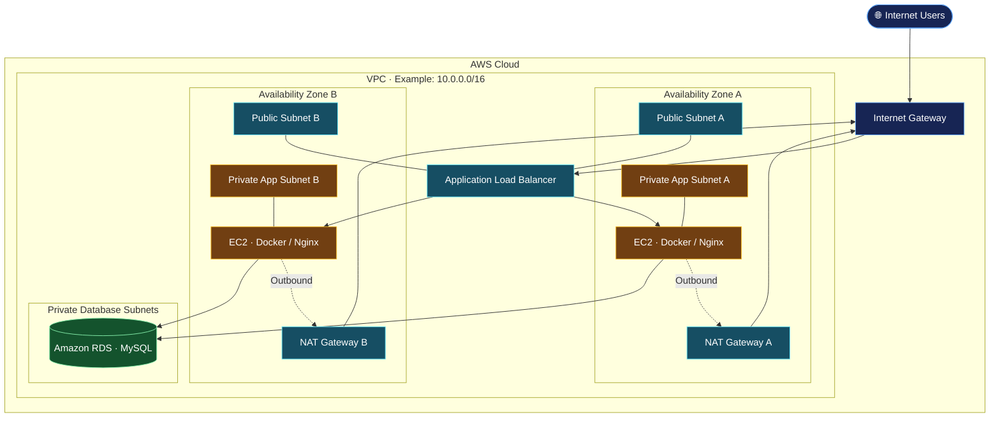

# AWS Two-Tier Architecture using Terraform

Terraform project for provisioning AWS infrastructure with public and private subnets across two Availability Zones, private application servers, and a protected database tier.

## 🏗️ Architecture



*The diagram illustrates the intended architecture. Confirm the actual Terraform resources before treating every component as deployed.*

## 🔍 How It Works

- **Public subnets:** Host the internet-facing load balancer and NAT Gateways.
- **Private application subnets:** Host EC2 instances running the application or Docker containers without direct inbound internet access.
- **Application Load Balancer:** Routes incoming requests to healthy application targets.
- **NAT Gateways:** Allow private instances to initiate outbound internet connections.
- **Private database tier:** Places Amazon RDS MySQL in private database subnets, with access restricted to authorized application resources.
- **Terraform:** Creates and manages the infrastructure through reusable configuration.

## 🛠️ Technologies

- AWS VPC, EC2, Subnets and Route Tables
- Internet Gateway and NAT Gateway
- Application Load Balancer
- Amazon RDS MySQL
- Security Groups
- Terraform
- Docker and Nginx

## ⚙️ Prerequisites

- AWS account with the required permissions
- Terraform
- AWS CLI
- Git

Verify the installation and AWS credentials:

```bash
terraform version
aws --version
aws sts get-caller-identity
```

## 🚀 Setup and Deployment

Clone the repository:

```bash
git clone https://github.com/devops-portfolio-vijay/terraform-aws-2tier-architecture.git
cd terraform-aws-2tier-architecture
```

Initialize Terraform:

```bash
terraform init
```

Format and validate the configuration:

```bash
terraform fmt -recursive
terraform validate
```

Review the proposed infrastructure changes:

```bash
terraform plan
```

Create the resources after reviewing the plan:

```bash
terraform apply
```

Enter `yes` when prompted. Provide any required variables using the configuration documented in the repository.

## ✅ Verify

Inspect the configured outputs:

```bash
terraform output
```

Use the load balancer DNS name, if provided, to access the application. Check the AWS Console to confirm the EC2 instances, subnets, security groups, and database status.

## 🧹 Cleanup

Remove resources managed by this configuration when they are no longer needed:

```bash
terraform destroy
```

Review the destruction plan before confirming. NAT Gateways and other provisioned resources can incur AWS charges while they exist.

## 🔐 Security

- Keep application instances and the database private.
- Allow application traffic to EC2 only from the load balancer security group.
- Allow MySQL traffic only from authorized application resources.
- Restrict administrative access to trusted sources.
- Never commit AWS credentials, database passwords, or sensitive Terraform state to GitHub.

---

**Repository:** [terraform-aws-2tier-architecture](https://github.com/devops-portfolio-vijay/terraform-aws-2tier-architecture)
