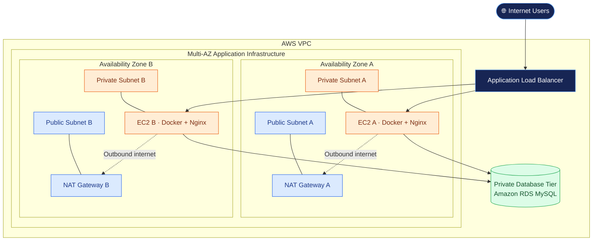

# AWS Two-Tier Architecture using Terraform

Infrastructure as Code project that provisions an AWS environment using Terraform, with public and private subnets across two Availability Zones, an application tier, and a private database tier.

## 🏗️ Architecture



*The diagram illustrates the intended design. Confirm that the resources shown are actually defined in the Terraform configuration.*

## 🔄 How It Works

1. Users send requests to the public Application Load Balancer.
2. The load balancer forwards requests to healthy EC2 instances in the private application subnets.
3. Docker runs Nginx on the application instances.
4. The application can connect to the private RDS MySQL database when database integration is configured.
5. NAT Gateways allow private instances to initiate outbound internet connections without requiring public IP addresses.

### Public vs. Private Subnets

| Component | Purpose |
|---|---|
| Public subnets | Host the internet-facing load balancer and NAT Gateways |
| Private application subnets | Host EC2 instances running the application |
| Private database subnets | Provide network placement for RDS |
| Internet Gateway | Enables internet routing for eligible public resources |
| NAT Gateways | Provide outbound internet connectivity for private resources |

## 🛠️ Technologies Used

- AWS VPC and Subnets
- Internet Gateway and NAT Gateway
- Application Load Balancer
- Amazon EC2
- Docker and Nginx
- Amazon RDS MySQL
- AWS Security Groups
- Terraform
- Git and GitHub

## 📁 Repository Structure

```text
terraform-aws-2tier-architecture/
├── *.tf
├── modules/
└── README.md
```

The exact files and module structure depend on the repository's Terraform configuration.

## ⚙️ Prerequisites

Install the following tools:

- [Terraform](https://developer.hashicorp.com/terraform/install)
- [AWS CLI](https://docs.aws.amazon.com/cli/latest/userguide/getting-started-install.html)
- [Git](https://git-scm.com/downloads)

You also need an AWS account with permission to create the required resources.

Verify the installations and AWS authentication:

```bash
terraform version
aws --version
aws sts get-caller-identity
```

Configure AWS credentials using a supported method. Never commit AWS credentials to the repository.

## 🚀 Setup and Deployment

### 1. Clone the Repository

```bash
git clone https://github.com/devops-portfolio-vijay/terraform-aws-2tier-architecture.git
cd terraform-aws-2tier-architecture
```

If the Terraform configuration is in a subdirectory, navigate to the appropriate directory before running the commands below.

### 2. Initialize Terraform

```bash
terraform init
```

Initializes the working directory and downloads the required providers.

### 3. Format and Validate

```bash
terraform fmt -recursive
terraform validate
```

Formats the configuration and checks its validity.

### 4. Review the Infrastructure Plan

```bash
terraform plan
```

Review the proposed AWS resources and changes before deployment.

### 5. Deploy the Infrastructure

```bash
terraform apply
```

Review the plan and enter `yes` when prompted.

Provide any required variables according to the repository's configuration and instructions.

## ✅ Verify the Deployment

Inspect the configured Terraform outputs:

```bash
terraform output
```

Verify the following resources in the AWS Console, where applicable:

- VPC and subnet associations
- Internet Gateway, NAT Gateways, and route tables
- Load balancer listeners and target health
- EC2 instances and Docker containers
- RDS status and database connectivity rules

If Terraform provides a load balancer DNS name, open it in a browser to test the application.

## 🔐 Security

- Keep application EC2 instances in private subnets.
- Allow application traffic only from the load balancer security group.
- Allow database connections only from authorized application resources.
- Restrict administrative access to trusted sources.
- Protect Terraform state and sensitive variable files.
- Never commit AWS credentials, database passwords, or private keys.

## 🧹 Cleanup

When the infrastructure is no longer needed, remove resources managed by Terraform:

```bash
terraform destroy
```

Review the destruction plan before confirming.

**Note:** NAT Gateways, load balancers, EC2 instances, and RDS databases can incur AWS charges while running.

---

**Repository:** [terraform-aws-2tier-architecture](https://github.com/devops-portfolio-vijay/terraform-aws-2tier-architecture)
