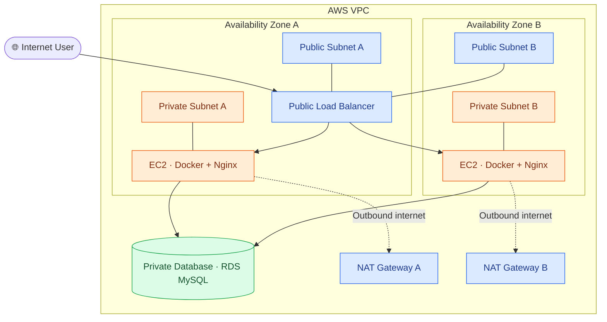

# AWS Two-Tier Architecture using Terraform

This project demonstrates how to provision AWS infrastructure using Terraform, with public and private subnets across two Availability Zones, private EC2 application instances, and a database tier.

## 🏗️ Architecture



### How It Works

- **Public subnets:** Host the internet-facing Application Load Balancer and NAT Gateways.
- **Private application subnets:** Host EC2 instances running Docker and Nginx without direct inbound internet access.
- **Load balancer:** Distributes incoming requests to healthy application instances.
- **NAT Gateways:** Allow private instances to initiate outbound internet connections.
- **Private database tier:** Hosts Amazon RDS MySQL, accessible only to authorized application resources.
- **Terraform:** Provisions and manages the AWS infrastructure using configuration files.

*The diagram represents the intended architecture. Confirm that each resource is defined in the Terraform configuration before treating it as deployed.*

## 🛠️ Technologies Used

- AWS VPC
- Public and Private Subnets
- Internet Gateway and NAT Gateway
- Application Load Balancer
- Amazon EC2
- Docker and Nginx
- Amazon RDS MySQL
- AWS Security Groups
- Terraform
- Git and GitHub

## 📁 Repository Structure

```text
terraform-aws-2tier-architecture/
├── *.tf
├── modules/
└── README.md
```

The exact files and module structure depend on the repository's Terraform configuration.

## ⚙️ Prerequisites

Install the following tools:

- [Terraform](https://developer.hashicorp.com/terraform/install)
- [AWS CLI](https://docs.aws.amazon.com/cli/latest/userguide/getting-started-install.html)
- [Git](https://git-scm.com/downloads)

You also need an AWS account with permissions to create the required resources.

Verify your setup:

```bash
terraform version
aws --version
aws sts get-caller-identity
```

Configure AWS credentials using a supported method, such as an AWS CLI profile. Never commit credentials to GitHub.

## 🚀 Deployment

### 1. Clone the repository

```bash
git clone https://github.com/devops-portfolio-vijay/terraform-aws-2tier-architecture.git
cd terraform-aws-2tier-architecture
```

If the Terraform configuration is in a subdirectory, navigate to that directory before running the commands below.

### 2. Initialize Terraform

```bash
terraform init
```

Initializes the working directory and downloads the required providers.

### 3. Format and validate

```bash
terraform fmt -recursive
terraform validate
```

Checks formatting and validates the Terraform configuration.

### 4. Review the deployment plan

```bash
terraform plan
```

Review the AWS resources Terraform intends to create or modify.

### 5. Deploy the infrastructure

```bash
terraform apply
```

Review the plan and enter `yes` when prompted.

Supply any required input variables using the configuration documented in the repository.

## ✅ Verify the Deployment

Inspect the configured Terraform outputs:

```bash
terraform output
```

Then verify the deployed resources in the AWS Console:

- VPC and subnet associations
- Internet Gateway and NAT Gateway routing
- Application Load Balancer and target health
- EC2 instance status
- RDS database status and connectivity rules

If a load balancer DNS output is available, open it in a browser to test the application.

## 🔐 Security

- Keep application EC2 instances in private subnets.
- Restrict application traffic to the load balancer security group.
- Allow database connections only from authorized application resources.
- Restrict administrative access to trusted sources.
- Protect Terraform state and sensitive variable files.
- Never commit AWS credentials, database passwords, or private keys.

## 🧹 Cleanup

When the infrastructure is no longer required, remove resources managed by Terraform:

```bash
terraform destroy
```

Review the destruction plan and confirm when prompted.

**Note:** AWS resources such as NAT Gateways, load balancers, EC2 instances, and RDS databases can incur charges while they exist.

---

**Repository:** [terraform-aws-2tier-architecture](https://github.com/devops-portfolio-vijay/terraform-aws-2tier-architecture)
