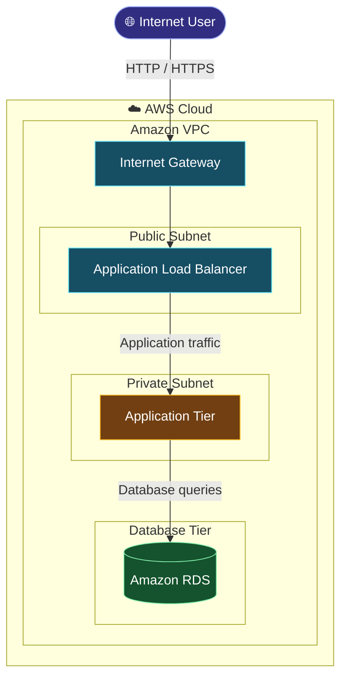

# AWS Two-Tier Architecture with Terraform

Infrastructure as Code project for provisioning a two-tier architecture on AWS using Terraform, with application and database resources separated into network tiers.

## 🏗️ Architecture



*The diagram illustrates the request flow; it is not a live animation. Replace any resources that are not present in the Terraform configuration.*

## 🛠️ Technologies

- AWS VPC and Subnets
- Terraform
- Amazon EC2
- Amazon RDS
- Application Load Balancer
- AWS Security Groups
- AWS IAM

## 📁 Repository Structure

```text
terraform-aws-2tier-architecture/
├── *.tf
├── modules/
└── README.md
```

The exact file and module structure depends on the files present in this repository.

## ⚙️ Prerequisites

- An AWS account with appropriate permissions
- Terraform installed
- AWS CLI installed and configured
- Git

Verify the tools and AWS authentication:

```bash
terraform version
aws --version
aws sts get-caller-identity
```

## 🚀 Deployment

Clone the repository:

```bash
git clone https://github.com/devops-portfolio-vijay/terraform-aws-2tier-architecture.git
cd terraform-aws-2tier-architecture
```

Navigate to the directory containing the root Terraform configuration, if required, then initialize:

```bash
terraform init
terraform fmt -recursive
terraform validate
terraform plan
```

Review the proposed changes and deploy:

```bash
terraform apply
```

Provide any required variables using the repository's documented configuration. Do not commit credentials or passwords to GitHub.

## 🔍 Verify and Clean Up

Inspect the Terraform outputs:

```bash
terraform output
```

Verify the deployed resources in the AWS Console and test the application using the endpoint provided by the project.

When the infrastructure is no longer required:

```bash
terraform destroy
```

Review the destruction plan before confirming.

## 🔐 Security

- Keep database resources private and restrict access to authorized application resources.
- Limit inbound traffic using security groups.
- Restrict administrative access to trusted IP addresses.
- Protect Terraform state and credentials.
- Review AWS costs before deployment.

---

**Repository:** [terraform-aws-2tier-architecture](https://github.com/devops-portfolio-vijay/terraform-aws-2tier-architecture)
