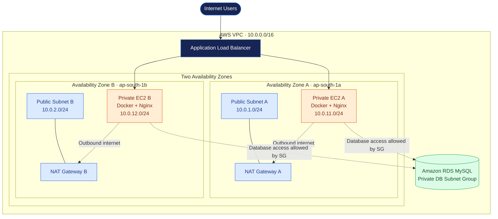

# AWS Two-Tier Architecture with Terraform

This project provisions AWS infrastructure using Terraform, deploying two private EC2 web servers running Docker and Nginx behind an internet-facing Application Load Balancer. The infrastructure spans two Availability Zones and includes a private Amazon RDS MySQL database.

## 🏗️ Architecture



**Request flow:** Internet user → Load balancer → Healthy private EC2 instance → Nginx response.

**Network layout:** AZ A is on the left and AZ B is on the right. Each zone has a public subnet and a private application subnet.

The RDS subnet group uses the two private subnets. The current configuration sets `multi_az = false`, so it does not enable RDS Multi-AZ failover.

## ⚙️ AWS Resources

| Resource | Configuration |
|---|---|
| VPC | `10.0.0.0/16` |
| Public subnets | `10.0.1.0/24`, `10.0.2.0/24` |
| Private subnets | `10.0.11.0/24`, `10.0.12.0/24` |
| Availability Zones | `ap-south-1a`, `ap-south-1b` |
| NAT Gateways | Two, one per AZ |
| Application Load Balancer | Internet-facing, HTTP port 80 |
| EC2 instances | Two Ubuntu `t3.micro` instances |
| Container | `nginx:alpine` |
| Database | Amazon RDS MySQL 8.0, `db.t3.micro` |
| Database name | `appdb` |
| Infrastructure as Code | Terraform |

## 🛠️ Technologies

- AWS VPC, Subnets and Route Tables
- Internet Gateway and NAT Gateway
- Application Load Balancer and Target Group
- Amazon EC2 and Docker
- Nginx
- Amazon RDS MySQL
- AWS Security Groups
- Terraform

## 📁 Repository Structure

```text
terraform-aws-2tier-architecture/
├── main.tf
├── variables.tf
├── outputs.tf
├── .terraform.lock.hcl
├── .gitignore
└── README.md
```

## 📋 Prerequisites

Install:

- [Terraform](https://developer.hashicorp.com/terraform/install)
- [AWS CLI](https://docs.aws.amazon.com/cli/latest/userguide/getting-started-install.html)
- [Git](https://git-scm.com/downloads)

You also need an AWS account with permissions to create the required networking, EC2, load-balancing, and RDS resources.

Configure your AWS credentials using a supported method, then verify:

```bash
aws sts get-caller-identity
terraform version
```

## 🚀 Deployment

### 1. Clone the repository

```bash
git clone https://github.com/devops-portfolio-vijay/terraform-aws-2tier-architecture.git
cd terraform-aws-2tier-architecture
```

### 2. Configure the EC2 public key

The configuration expects a public key at:

```text
~/.ssh/terraform-2tier.pub
```

Create a key pair if you do not already have one:

```bash
ssh-keygen -t ed25519 -f ~/.ssh/terraform-2tier
```

The `.pub` file is the public key Terraform needs. Keep the private key secure and never commit it to GitHub.

### 3. Initialize Terraform

```bash
terraform init
```

### 4. Format and validate

```bash
terraform fmt -recursive
terraform validate
```

### 5. Configure the database password

The `db_password` variable is sensitive and has no default. Supply a strong password securely at deployment time.

For example, use a local, untracked `terraform.tfvars` file:

```hcl
db_username     = "admin"
db_password     = "REPLACE_WITH_A_STRONG_PASSWORD"
public_key_path = "~/.ssh/terraform-2tier.pub"
key_name        = "terraform-2tier-key"
```

Replace the placeholder before deployment. Ensure the file is excluded by `.gitignore` and never commit it. For shared or production environments, prefer a secure secret-management workflow.

### 6. Review and deploy

```bash
terraform plan
terraform apply
```

Review the proposed changes and enter `yes` when prompted.

Terraform provisions the network, NAT Gateways, EC2 instances, load balancer, target group, security groups, and RDS resources defined in `main.tf`.

## 🌐 Access the Application

After deployment, retrieve the load balancer DNS name from the AWS Console or Terraform state/resources.

Open the HTTP endpoint:

```text
http://<LOAD_BALANCER_DNS_NAME>
```

The EC2 user-data scripts install Docker, pull `nginx:alpine`, create a static HTML page, and start the Nginx container.

The load balancer health check uses `/` and expects HTTP `200`.

## 🔍 Verify the Infrastructure

Inspect Terraform outputs:

```bash
terraform output
```

The current outputs include the VPC ID, subnet IDs, EC2 instance IDs, and private IP addresses.

In the AWS Console, verify:

- Both public and private subnet route-table associations.
- Both NAT Gateways and their Elastic IPs.
- Load balancer target health.
- EC2 instance and Docker container status.
- RDS availability and its private subnet group.

**Database note:** The project provisions RDS MySQL and a security-group rule allowing TCP port `3306` from the web-server security group. The current Nginx page is static and does not query the database.

## 🔐 Security Considerations

- The EC2 instances are deployed in private subnets without public IP assignment.
- The load balancer accepts HTTP traffic on port `80`.
- The database is configured with `publicly_accessible = false`.
- Database inbound traffic is restricted to the web-server security group.
- **SSH currently allows inbound port `22` from `0.0.0.0/0`.** Restrict this to your trusted IP address or use a managed access method before deployment.
- Protect Terraform state, private keys, and database credentials.
- Use HTTPS and appropriate secret management for production workloads.

## 🧹 Cleanup

To remove resources managed by Terraform:

```bash
terraform destroy
```

Review the destruction plan and confirm when prompted. The configuration currently disables RDS deletion protection and skips the final snapshot, so back up any database data you need before destroying the infrastructure.

NAT Gateways, load balancers, EC2 instances, and RDS may incur AWS charges while provisioned.

---

**Repository:** [terraform-aws-2tier-architecture](https://github.com/devops-portfolio-vijay/terraform-aws-2tier-architecture)
